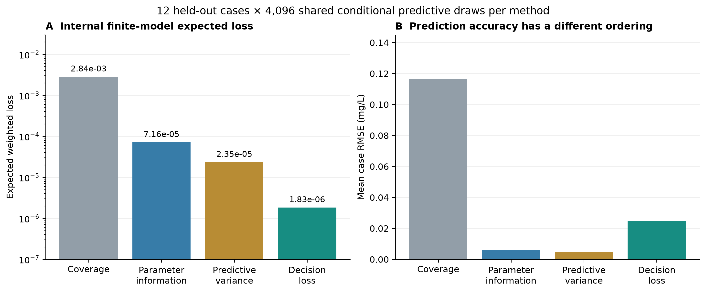

# Groundwater Inversion and Monitoring Design

A computational groundwater study that asks **which four of 24 existing monitoring locations should be sampled to improve a future contamination decision?** A conservative finite-volume model supplies concentration responses; Bayesian inversion updates uncertain conductivity and release amplitudes; batch design compares spatial coverage, parameter information, predictive variance and decision loss.

The experiments compare decision-focused sampling across a finite parameter ensemble, continuous-prior cases and mesh/time mismatch tests. The results connect sampling objectives to prediction error, decision loss and interval coverage.



The left panel averages conditional expected loss; the right averages case-level concentration RMSE. These metrics answer different questions. [View full size](figures/02_internal_risk_and_prediction.png).

## Experiment

- A 1,400 m × 1,800 m aquifer with a low-conductivity lens and an injection/extraction pair; geometry derives from the public MT3DMS Problem 9 example.
- Five uncertain parameters: two log-conductivity multipliers and three independent release amplitudes at one known injection footprint.
- Day-180 observations: three concentrations and two hydraulic heads. Choose four simultaneous day-365 samples to assess day-545 concentration at a receptor.
- A 1,125-state weighted tensor rule, 25 m cells and 2-day steps. Selection uses 256 predictive draws; evaluation uses a separate 4,096 draws per case.
- An experimental threshold of 0.6 mg/L and false-negative/false-positive costs of 9:1.

## Results

The frozen main study contains three development cases and **12 held-out cases**. The table reports the mean over held-out cases, with identical conditional predictive draws shared across methods within each case.

| Sampling objective | Mean expected weighted loss | Mean case RMSE (mg/L) |
|---|---:|---:|
| Spatial coverage | 2.844 × 10⁻³ | 0.11630 |
| Parameter information | 7.155 × 10⁻⁵ | 0.00607 |
| Predictive variance | 2.348 × 10⁻⁵ | 0.00455 |
| Decision loss | 1.833 × 10⁻⁶ | 0.02457 |

Source: [held-out metrics](results/heldout_results.json). The finite-model decision objective and concentration RMSE have different orderings. Expected weighted loss is computed under the conditional predictive distribution.


The more demanding **64-case continuous-prior test** reveals severe undercoverage: decision-loss sampling covers only **14/64** true receptor concentrations in nominal 95% intervals. Its mean realized weighted loss is **1.000**, versus **0.578** for parameter-information and predictive-variance sampling. A further 16-case mesh/time mismatch test has 0/16 post-sampling coverage for all three model-based methods. [Detailed results and numerical checks](docs/results.md).

## Run

Use Python 3.12 and run commands from the repository root:

```bash
python3.12 -m venv .venv
source .venv/bin/activate
python -m pip install -r requirements.txt
python physics.py
python check_inference.py
python examples/math_examples.py
```

On Windows, activate with `.venv\Scripts\activate`. The custom solver runs on a CPU and needs no external executable or dataset.

Rebuild all eight figures and English CSV well reports from the included numerical archive:

```bash
python make_figures.py
```

Run the complete main experiment in a fresh directory:

```bash
python reproduce_main.py --out results/reproduction
# Add --stress to reproduce the enumeration and 80 exploratory stress cases.
```

[Reproduction guide](docs/reproduction.md) explains archive contents, optional MODFLOW verification, environment versions and output handling. [Methods](docs/methods.md) describes the equations, Bayesian calculation, design criteria and invariance checks.

## Code and outputs

| Entry | Purpose |
|---|---|
| [physics.py](physics.py) | Darcy flow, upwind transport, diagonal dispersion, mass budgets and source basis responses |
| [inference_design.py](inference_design.py) | Weighted response library, posterior updates, predictive evaluation and greedy batch design |
| [stress_tests.py](stress_tests.py) | Exhaustive small-pool audit, continuous-prior truths and numerical mismatch tests |
| [protocol.json](protocol.json) | Main settings, fixed seeds and historical execution metadata |
| [results/](results/) | Main cases and arrays, stress metrics, enumeration and CSV sampling plans |
| [physics_results/](physics_results/) | Saved conservation, analytical, resolution and matched-solver evidence |
| [figures/](figures/) | Eight PNG figures |

