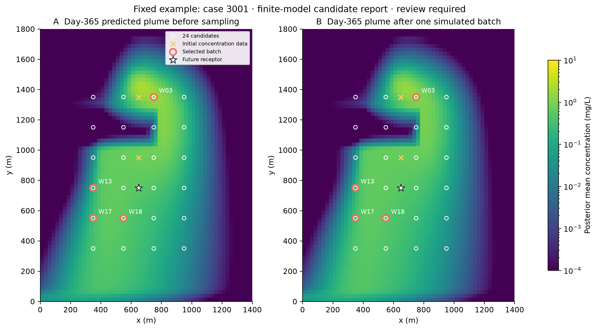
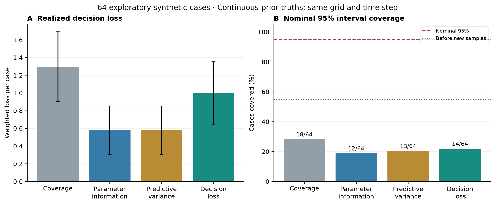
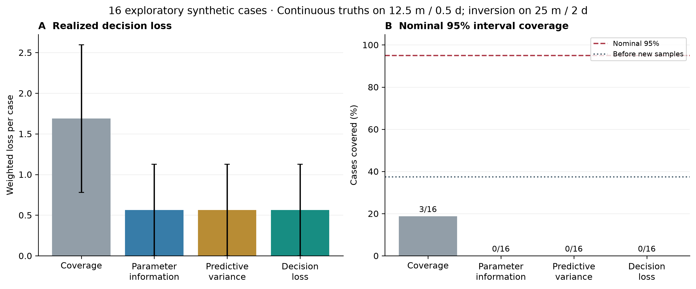
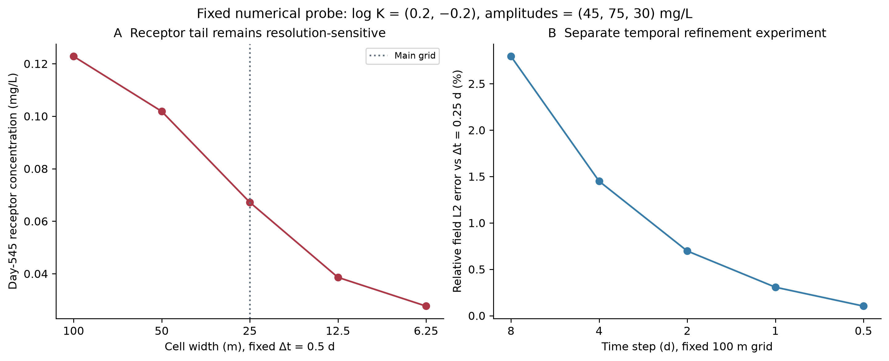
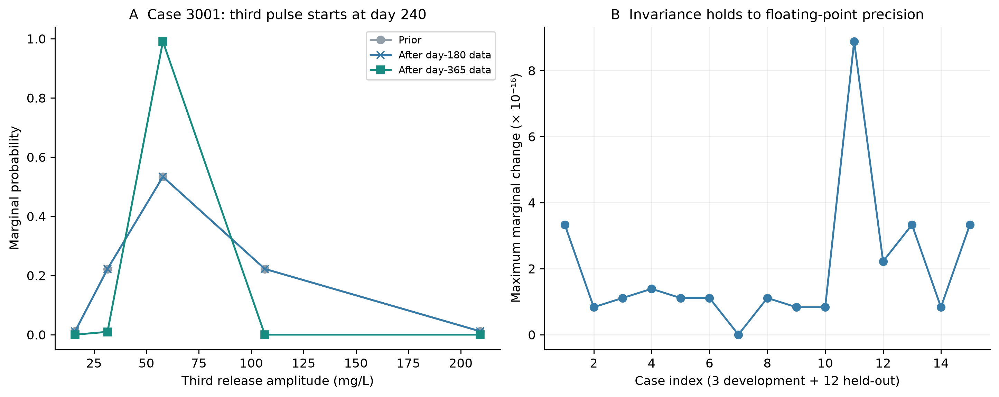
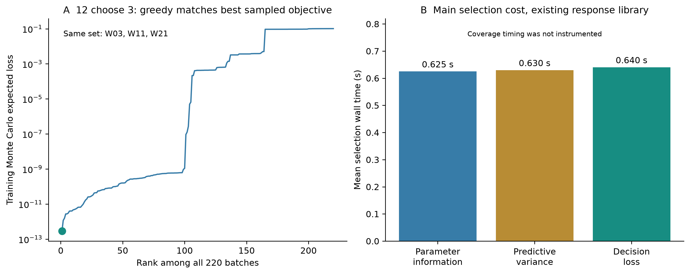
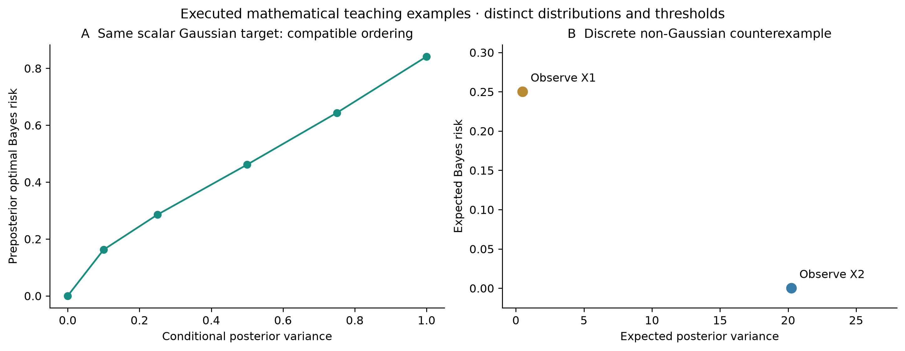

# Results and Numerical Evidence

[Project overview](../README.md) · [Methods](methods.md) · [Reproduction](reproduction.md)

## Frozen main experiment

Development seeds are 1101–1103 and held-out seeds are 3001–3012. Each main case draws truth from the 1,125-state weighted model, generates initial observations, selects each four-location batch and evaluates it with 4,096 independent conditional predictive draws. This is a finite-model study. The held-out seeds were fixed separately from development.

The figures and CSV exports use the frozen main protocol in [`protocol.json`](../protocol.json). Preliminary coarse-grid and joint-Sobol studies are excluded from this release and from all reported tables.

| Method | Cases | Mean conditional expected loss | Mean case RMSE (mg/L) | False negatives | False positives |
|---|---:|---:|---:|---:|---:|
| Coverage | 12 | 0.00284377 | 0.116303 | 0 | 149 |
| Parameter information | 12 | 0.00007155 | 0.006070 | 0 | 5 |
| Predictive variance | 12 | 0.00002348 | 0.004546 | 0 | 0 |
| Decision loss | 12 | 0.00000183 | 0.024572 | 0 | 0 |

False-positive/negative counts sum 12 × 4,096 conditional predictive draws per method. Those draws share the same model and are clustered within 12 initial datasets; they are not 49,152 independent physical sites. Expected loss can remain positive even when no erroneous decisions are realized in this finite predictive sample.

The table is calculated from [`heldout_results.json`](../results/heldout_results.json). Complete per-case selection traces, predictive metrics and illustrative updates are in `results/case_3001.json` through `case_3012.json`; the corresponding NPZ files retain the saved observations, posterior weights and per-draw arrays. [`figure_data_summary.json`](../results/figure_data_summary.json) also records paired Monte Carlo uncertainty and between-case uncertainty for the decision-loss versus predictive-variance risk difference.

## A concrete batch

Case 3001 is a fixed example, rather than a best-performing case chosen for display. The figure shows posterior mean day-365 concentration before and after its illustrative observations. Open circles mark candidate footprints; red outlines mark the decision-loss batch. Coordinates refer to virtual 100 m monitoring footprints. The four wells are sampled together at day 365.

The English [sampling plan](../results/sampling_plan.csv), [candidate coordinates](../results/candidate_wells.csv) and [four-plan comparison](../results/plan_comparison.csv) connect the figure to a checkable list of locations and model-based metrics. Their status remains “research candidate” because the tests below fail calibration requirements.

## Continuous-truth stress test

The 64 same-model stress cases use seeds 4001–4064 and independently draw all five parameters from their continuous priors. Truth uses the same 25 m grid and 2-day step as inversion. Its parameters generally lie between quadrature nodes.

| Method | Post-sampling nominal 95% interval coverage | Mean realized weighted loss | False negatives / 22 exceedances | False positives |
|---|---:|---:|---:|---:|
| Coverage | 18/64 (28.1%) | 1.296875 | 9/22 | 2 |
| Parameter information | 12/64 (18.8%) | 0.578125 | 4/22 | 1 |
| Predictive variance | 13/64 (20.3%) | 0.578125 | 4/22 | 1 |
| Decision loss | 14/64 (21.9%) | 1.000000 | 7/22 | 1 |

Before new sampling, interval coverage is only 35/64 (54.7%) for every method. More observations often concentrate weights on very few discrete states, worsening interval coverage. The decision-loss ordering in the finite model does not transfer to this test. The mean realized loss is the observed weighted error cost across these cases, not the internal expected risk shown in the main table.

Bars for realized loss include case-based standard errors. The dashed horizontal line is the nominal 95% coverage level. Source: [`stress_summary.json`](../results/stress_summary.json); all 320 method-by-case records from both stress groups are available in [JSON](../results/stress_results.json) and [CSV](../results/stress_results.csv).

## Numerical mismatch

The 16 mismatch cases use seeds 5001–5016. Truth uses 12.5 m cells and 0.5-day steps; inversion retains 25 m cells and 2-day steps. Four truth cases exceed the concentration threshold.

| Method | Post-sampling interval coverage | Mean realized weighted loss | False negatives |
|---|---:|---:|---:|
| Coverage | 3/16 | 1.6875 | 3 |
| Parameter information | 0/16 | 0.5625 | 1 |
| Predictive variance | 0/16 | 0.5625 | 1 |
| Decision loss | 0/16 | 0.5625 | 1 |

This is an exploratory sensitivity test with only 16 cases. It does not support claims of robustness to arbitrary geological or transport-model mismatch.

## Numerical solver evidence

The saved [physical validation report](../physics_results/validation.json) covers a linear-head fixture, a closed-domain diffusion solution, positivity, source superposition, parameter corners, time refinement and grid refinement. Diffusion errors decrease at approximately second order under the coupled spatial/time refinement used by that analytical test. That property does not establish second-order accuracy of the main upwind transport problem.

The nominal archived mass-balance relative error is approximately 1.75 × 10⁻¹⁵, and source-superposition error is approximately 3.47 × 10⁻¹⁷ mg/L. These are algebraic conservation and linearity checks. Accuracy still depends on resolution.

For one fixed numerical probe, with log-conductivity multipliers (0.2, −0.2), amplitudes (45, 75, 30) mg/L and a 0.5-day step:

| Cell width | Day-545 receptor concentration (mg/L) |
|---|---:|
| 100 m | 0.122795 |
| 50 m | 0.101836 |
| 25 m | 0.067183 |
| 12.5 m | 0.038605 |
| 6.25 m | 0.027656 |

The receptor tail remains grid-sensitive. The [fine-grid report](../physics_results/fine_grid_check.json) and retained fields document that sensitivity rather than presenting the finest tested grid as an exact solution. The time-step panel is a separate controlled probe on the base grid.

A saved [MODFLOW 6 matched-equation audit](../physics_results/mf6_audit.json) reports concentration relative L2 difference 1.29 × 10⁻¹⁰ and maximum head difference 1.67 × 10⁻⁹ m. This agreement applies to steady flow, upstream advection, zero dispersion and 1-day steps. The audit also ran a TVD/full-dispersion reference configuration, but agreement with that different configuration is not claimed. The separate MT3DMS executable was not run.

## Structural and objective checks

Across all 15 main cases, the day-180 marginal distribution of the independent third release amplitude changes by at most 8.88 × 10⁻¹⁶ in probability. Its day-180 response is exactly zero. This checks a causal independence property that a poorly constructed discrete prior can violate.

An exploratory search enumerates all 220 batches of size three from a fixed 12-location subpool for development case 1102. The greedy and enumerated solutions select the same set, W03/W11/W21. The search is exhaustive for that sampled objective and subpool, not a global guarantee for all 24-location, four-sample problems or the population expectation. [Enumeration evidence](../results/stress_enum.json).

Coverage selection time was not instrumented; its stored zero is a placeholder. Timings for the other methods exclude response-library construction and depend on hardware.

## Mathematical examples

The executable [mathematical examples](../examples/math_examples.py) distinguish a compatible scalar Gaussian ordering from a discrete non-Gaussian counterexample. They also check posterior weights and the downward bias of an empirical plug-in Bayes-risk estimate. Their values are mathematical fixtures with their own distributions and thresholds; they are separate from the groundwater performance results.
